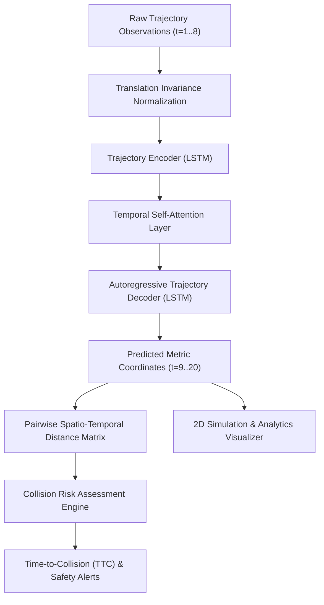
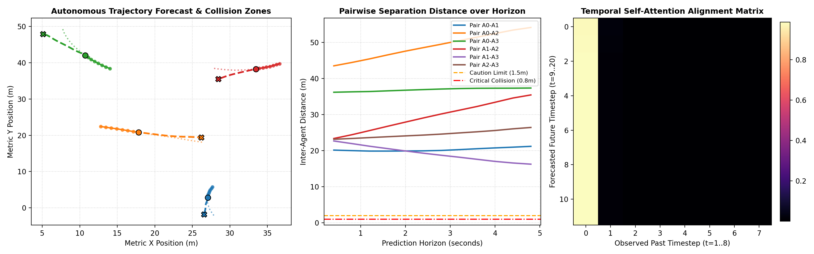
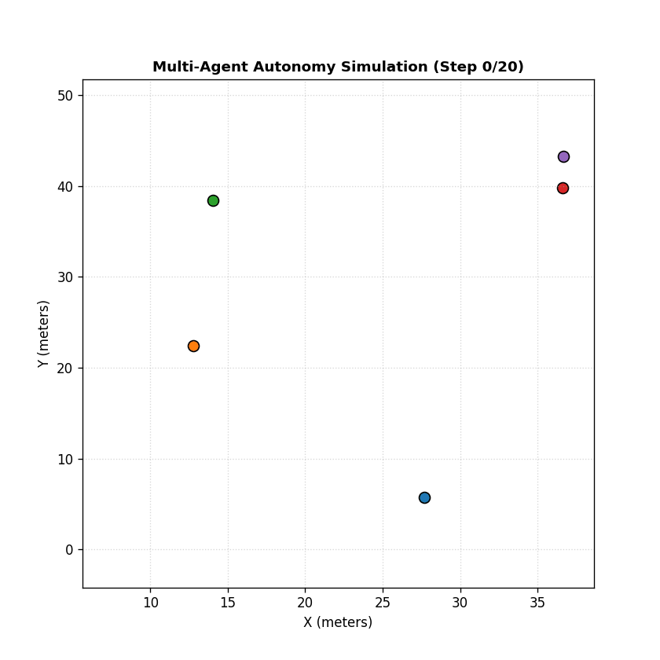

# 🛰️ TrajectoryRisk-AI: Spatio-Temporal Trajectory Forecasting & Collision Risk Engine

[](https://www.python.org/)
[](https://pytorch.org/)
[](https://developer.nvidia.com/cuda-zone)
[](#)
[](LICENSE)

An end-to-end deep learning framework for **non-linear trajectory forecasting** and **spatio-temporal collision risk estimation** in autonomous mobile robots, multi-UAV swarms, and intelligent transportation systems.

---

## 📌 Key Highlights

- **Spatio-Temporal Deep Learning:** Recurrent Seq2Seq architecture equipped with **Bahdanau Temporal Self-Attention** to dynamically weigh critical kinematic maneuvers (turns, acceleration, evasions).
- **Robotics-Standard Benchmarking:** Evaluated against constant-velocity kinematic baselines using metric-space **Average Displacement Error (ADE)** and **Final Displacement Error (FDE)**.
- **Dynamic Collision Risk Engine:** Computes pairwise multi-agent Euclidean proximities, **Time-to-Collision (TTC)**, and normalized **Collision Risk Indices (CRI)** over continuous planning horizons.
- **Ultra-Low Latency Inference:** Sub-**2.0 ms** execution per trajectory forecast on edge/laptop GPUs, supporting high-throughput (>500 Hz) autonomy control loops.
- **Visual Analytics Dashboard:** Automated generation of 2D trajectory forecasts, temporal attention alignment heatmaps, and dynamic simulation GIF animations.

---

## 🏗️ System Architecture



---

## 📊 Empirical Benchmark Results

Evaluated on standardized multi-agent trajectory test sequences over an observation horizon $T_{obs} = 8$ (3.2s) and prediction horizon $T_{pred} = 12$ (4.8s):

| Model Architecture | ADE (meters) ↓ | FDE (meters) ↓ | RMSE (meters) ↓ | Latency / Sample |
| :--- | :---: | :---: | :---: | :---: |
| **Constant Velocity (Kinematic Baseline)** | 0.8813 m | 2.1548 m | 1.1396 m | **0.028 ms** |
| **Seq2Seq + Temporal Attention (Ours)** | **0.6793 m** | **1.7869 m** | **0.8872 m** | **1.982 ms** |
| **Relative Performance Improvement** | **-22.91%** | **-17.07%** | **-22.15%** | *Real-Time Ready* |

---

## 🖼️ Visual Results Preview

### 1. Multi-Agent Evaluation Dashboard

*Left: 2D Spatial trajectory forecast with dynamic collision alert bubbles. Center: Pairwise distance profiles over time with safety threshold boundaries. Right: Attention alignment weights across temporal timesteps.*

### 2. Multi-Agent Dynamic Autonomy Simulation

*Dynamic simulation showing real-time multi-agent movement, forward AI trajectory projections, and reactive proximity alerts.*

---

## 📂 Project Structure

```
├── data/
│   ├── train_trajectories.csv       # Training trajectory dataset (500 agents, 10k rows)
│   └── test_trajectories.csv        # Validation/Test dataset (150 agents, 3k rows)
├── src/
│   ├── __init__.py                  # Package init
│   ├── dataset.py                   # PyTorch Trajectory Dataset & sliding-window loader
│   ├── baseline_model.py            # Constant Velocity kinematic extrapolation baseline
│   ├── seq2seq_attention.py         # PyTorch Seq2Seq Encoder-Decoder with Temporal Attention
│   ├── metrics.py                   # ADE, FDE, and RMSE evaluation metrics
│   ├── train.py                     # CUDA-accelerated training pipeline & checkpointing
│   ├── collision_risk.py            # Pairwise proximity, TTC, and collision risk index
│   └── visualizer.py                # Dashboard & dynamic simulation GIF renderer
├── scripts/
│   └── generate_dataset.py          # Multi-agent synthetic & benchmark scenario generator
├── checkpoints/
│   └── best_model.pt                # Serialized trained model weights (SmoothL1-optimized)
├── results/
│   ├── training_curves.png          # Convergence loss & validation error curves
│   ├── trajectory_collision_demo.png# 3-panel publication evaluation dashboard
│   ├── trajectory_animation.gif     # Dynamic multi-agent simulation GIF
│   └── benchmark_summary.json       # Quantitative performance report
├── evaluate.py                      # One-click comprehensive evaluation benchmark script
├── VIVA_DEFENSE_GUIDE.md            # Comprehensive viva questions, math, and oral defense answers
├── requirements.txt                 # Dependencies
└── README.md                        # Documentation
```

---

## ⚡ Quick Start

### 1. Environment Setup
```bash
# Clone the repository
git clone <your-repo-url>
cd <repo-folder>

# Install required dependencies
pip install -r requirements.txt
```

### 2. Generate Trajectory Datasets
```bash
python scripts/generate_dataset.py
```

### 3. Train the Model
```bash
python -m src.train
```

### 4. Interactive Live Autonomy Simulation
```bash
# Normal multi-agent tracking (Safe clearance > 2.0m)
python demo_live.py

# Critical intersection crossing scenario with dynamic collision detection & TTC alerts
python demo_live.py --scenario collision
```

### 5. Edge Hardware Latency & Throughput Profiler
```bash
python scripts/edge_latency_profiler.py
```

### 6. Run Full Quantitative Benchmark & Evaluation
```bash
python evaluate.py
```

### 7. Generate Visual Dashboard & Animations
```bash
python -m src.visualizer
```

---

## 📖 Theoretical Formulation

### Average Displacement Error (ADE)
$$\text{ADE} = \frac{1}{N \cdot T_{pred}} \sum_{i=1}^N \sum_{t=1}^{T_{pred}} \sqrt{(\hat{x}_{i,t} - x_{i,t})^2 + (\hat{y}_{i,t} - y_{i,t})^2}$$

### Final Displacement Error (FDE)
$$\text{FDE} = \frac{1}{N} \sum_{i=1}^N \sqrt{(\hat{x}_{i,T_{pred}} - x_{i,T_{pred}})^2 + (\hat{y}_{i,T_{pred}} - y_{i,T_{pred}})^2}$$

### Temporal Bahdanau Attention
$$\alpha_{t, i} = \frac{\exp(e_{t, i})}{\sum_{k=1}^{T_{obs}} \exp(e_{t, k})}, \quad \text{where } e_{t, i} = \mathbf{v}^\top \tanh(\mathbf{W}_{enc} \mathbf{h}_i + \mathbf{W}_{dec} \mathbf{s}_t)$$

---

## 👨‍💻 Author
**LKSHAY TYAGI**  
*SRM Institute of Science and Technology, Delhi-NCR*  
*Specialization: Autonomous Systems, Robotics & Embedded Intelligence*
